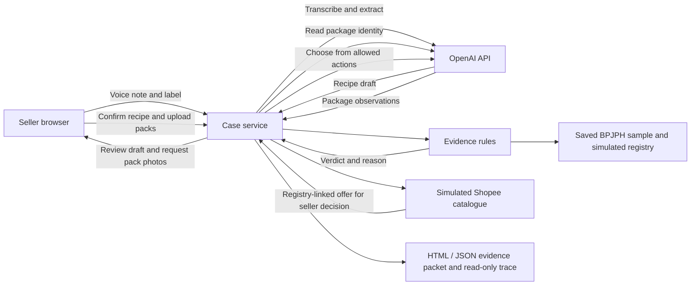

# Telusur Halal

Telusur Halal helps Indonesian micro and small food sellers turn a Bahasa Indonesia voice note, a product label, and ingredient pack photos into a traceable evidence packet for facilitator review.

**Review the MVP** · [Run locally](#run-the-mvp) · [D01 demo inputs](demo/README.md) · [Verification results](docs/mvp-verification.md)

## Architecture

The model reads seller inputs and chooses the next step. The server decides whether evidence meets the rules, and the seller confirms the recipe and decides whether to approve a proposed substitute.



1. **Confirm the recipe.** Transcribe the voice note and combine it with the label photo to draft an ingredient list. The seller can correct the draft before evidence checks begin. [Model integration](src/model.ts) · [Seller UI](public/app.js)
2. **Check the evidence.** Read the pack and match the declared ingredient, product, manufacturer, and variant against the registry. A readable certificate number on the pack must agree with the match. Conflicts and repack history survive recipe edits. [Evidence rules](src/rules.ts) · [BPJPH adapter](src/bpjph.ts)
3. **Choose the next action.** The model selects from actions the server allows, such as requesting a clearer photo, searching for a comparable product in the simulated Shopee catalogue, or referring a gap to a facilitator. The seller can approve or decline the offer and consider at most one alternative. [Case service](src/service.ts)
4. **Export for review.** The packet lists current ingredients, source references, unresolved gaps, and the facilitator checklist. Approved substitutes stay in a separate section pending adoption. The read-only trace shows what the app checked, rejected, and tried next. [Packet builder](src/packet.ts) · [Trace grader](src/grader.ts)

## Tech stack

| Layer | Technology | Role |
| --- | --- | --- |
| Browser | HTML, CSS, vanilla JavaScript, MediaRecorder | Record or upload audio, upload photos, review ingredients, decide on substitutes, download and replay traces |
| Backend | Node.js 22+, TypeScript, Express, Multer | Serve the UI and API, accept multipart uploads, enforce seller authority, and manage cases in memory |
| AI | OpenAI Audio Transcriptions and Responses APIs | `gpt-4o-mini-transcribe` for Bahasa Indonesia audio. `gpt-4.1-mini` for structured label and pack readings and constrained tool calls. Defaults are configurable in [`.env.example`](.env.example). |
| Contracts and data | Zod, local JSON and YAML | Validate inputs and model outputs, load the saved BPJPH sample and the simulated registry, catalogue, and evaluation fixtures |
| Verification | Node test runner, TypeScript, browser smoke test, independent D01 grader | Check rules and permissions, exercise the browser flow, and score the downloaded trace and packet |

## What to look for in the demo

| Try this in D01 | Expected result |
| --- | --- |
| Submit the Pedas pack for an ingredient declared as Original | The app rejects the mismatch. The corrected Original pack can pass. |
| Review the simulated Shopee offer for loose chili | The product card shows the shop, price, and registry link. Approval records a conditional substitute while the current chili stays unresolved. |
| Download the evidence packet and trace | Each outcome has a reason and source. The packet keeps current ingredients separate from proposed changes. |

D01 sends synthetic Bahasa Indonesia audio and simulated pack images to the configured OpenAI API. BPJPH lookups use a saved public search sample. The prototype delivers evidence for facilitator review. Supplier contact, purchases, certification decisions, and official submission are outside its scope.

## Run the MVP

Use Node.js 22 or newer. Install the pinned dependencies, copy the environment template, and set `OPENAI_API_KEY` in the ignored `.env` file.

```sh
npm ci
cp -n .env.example .env
npm run dev
```

Open [the local seller screen](http://127.0.0.1:4173). The app sends uploaded audio and photos to the configured OpenAI API for transcription and image reading. The case store is in memory. Download the HTML or JSON packet and the read-only trace before closing the case or restarting the server.

For the full D01 flow, use the [demo input guide](demo/README.md). Confirm the draft, upload the Sentosa oil pack, then submit Pedas and Original for the seasoning in that order. Approve the simulated Shopee plan and export the packet. Use **Putar ulang jejak tersimpan** on the start screen to open a downloaded trace locally.

```sh
npm run typecheck
npm test
npm run test:images
npm run compare:policy
# With the server running and agent-browser installed
bash demo/browser-d01.sh
```

See the [verification report](docs/mvp-verification.md) for the browser run, vision cases, and evaluation limits.

## Shared dataset

The app also matches package evidence against the normalized BPJPH public search snapshot from [PR #1](https://github.com/galihcitta/telusur-halal/pull/1), collected on 7 November 2026. The snapshot is an offline keyword sample. Matches cite the BPJPH search and distinguish a certificate number read from the pack from one returned by the snapshot. The simulated registry and Shopee catalogue support the original demo. See [the imported records](datasets/bpjph-demo/products.json).


Start with the [dataset guide](datasets/README.md). The pack-photo dataset includes registry and catalogue seeds, development and adversarial scenarios, pack images, intake transcripts and expected results. See [pre-event asset declarations](docs/declarations.md) for provenance.

## Background

See the [PRD v8](docs/prd-telusur-en.html) for the current hackathon contracts and acceptance gates, and the [MVP plan](docs/mvp-plan.md) for the build order and demo. Version 8 applies the adversarial review and replaces the original v7, which remains in Git history. The local design images under `docs/prd-assets/` are visual references; their sample copy and states are superseded by v8.

See [the hackathon proposal](docs/background.md) for the motivation, planned workflow, evaluation goals, and team background. It records the original proposal; regulatory statements and delivery targets should be verified before implementation.
