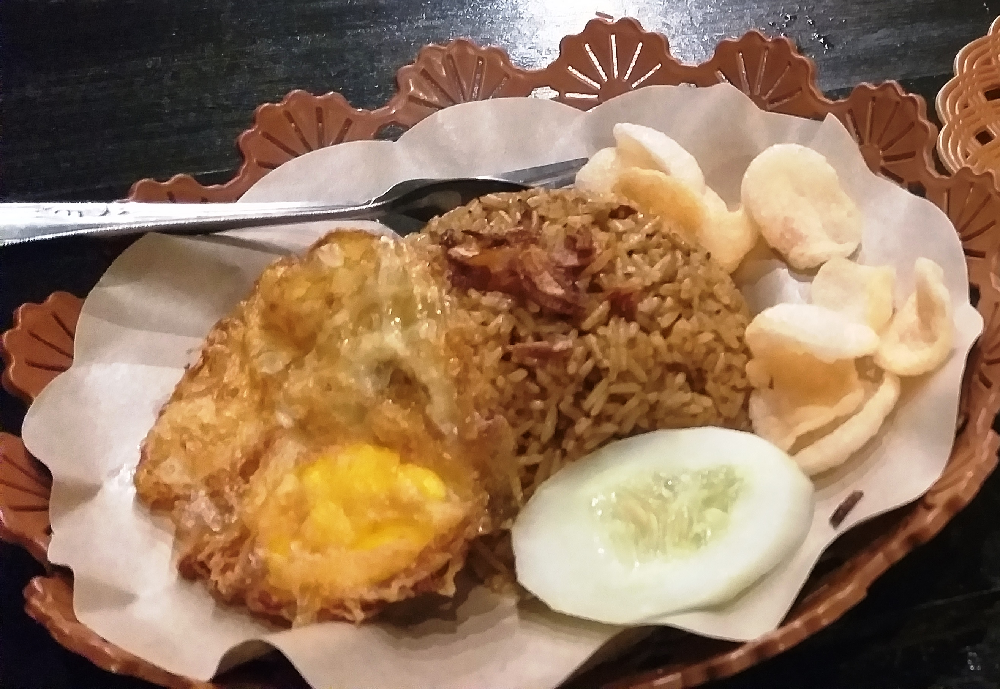
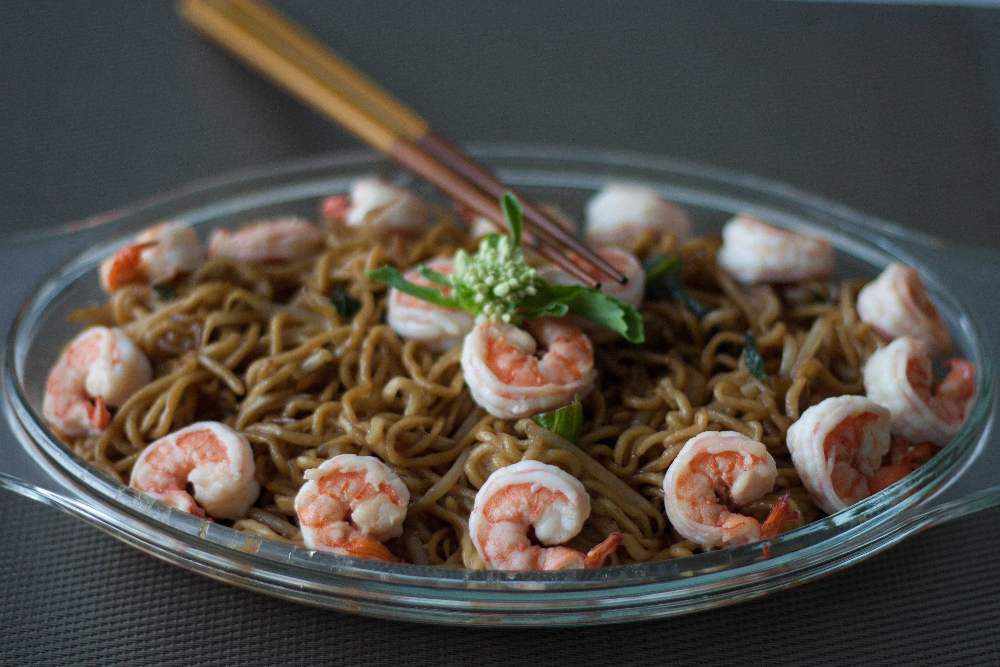
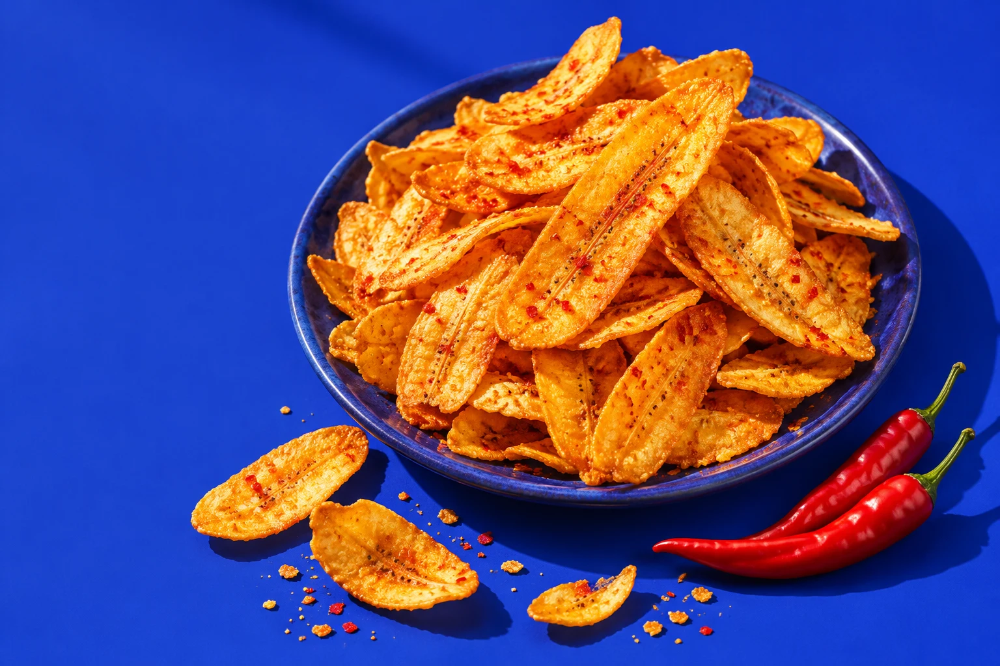

# Evaluasi foto masakan

Dataset development untuk menguji `createModel().readDish()` yang digunakan aplikasi saat ini. Tujuannya mengukur **pengenalan makanan dan bahan yang terlihat**, bukan memastikan resep lengkap atau status halal. Foto dan label referensi hanya dipakai oleh evaluator; tidak dimasukkan ke prompt atau dijadikan contoh jawaban untuk model.

Semua anotasi awal berstatus **draft**, dibuat dari pemeriksaan visual sebelum baseline model dijalankan. Evaluator perlu meninjau nama makanan, alias dan bahan sebelum mengubah `annotation.status` menjadi `reviewed`. Set awal ini kecil, publik, dan bukan held-out independen. Foto pengguna dalam manifest field disimpan privat dan juga termasuk development. Foto web mungkin pernah masuk data pelatihan model.

## Referensi awal

| ID | Gambar | Bahan terlihat yang wajib dikenali | Bahan opsional | Yang tidak boleh ditebak |
| --- | --- | --- | --- | --- |
| dish-001 | Nasi goreng, foto publik | Nasi, telur, mentimun, kerupuk | Bawang goreng | Minyak, garam, gula, kecap, kaldu, terasi |
| dish-002 | Mi goreng, foto publik | Mi, udang | Sayuran hijau tanpa penentuan spesies | Minyak, garam, gula, kecap, kaldu, bawang putih, ayam |
| dish-003 | Keripik pisang, ilustrasi sintetis | Pisang | Cabai yang terlihat di luar piring | Minyak, garam, gula, kecap, kaldu, tepung, identitas bubuk bumbu |
| reject-001 | Label produk simulasi | Harus ditolak (`null`) | — | Nama makanan/resep yang hanya berasal dari tulisan label |
| reject-002 | Gambar putih kosong sintetis | Harus ditolak (`null`) | — | Makanan atau bahan apa pun |

Cabai pada ilustrasi adalah properti visual, bukan bukti bahwa cabai digunakan dalam resep. Kerupuk dan mi juga dinilai sebagai komponen terlihat; bahan pembentuknya tidak boleh ditebak dari foto. Foto publik tidak memiliki resep terverifikasi untuk porsi yang dipotret, sehingga `recipe_reference` dibiarkan `null`.

### Nasi goreng



Foto oleh **Supardisahabu**, [sumber Wikimedia Commons](https://commons.wikimedia.org/wiki/File:Nasi_Goreng_Kampung.jpg), [CC BY-SA 4.0](https://creativecommons.org/licenses/by-sa/4.0/). Berkas asli disalin tanpa perubahan. Deskripsi umum resep di halaman sumber tidak diperlakukan sebagai komposisi terverifikasi untuk foto.

### Mi goreng



Foto oleh **مانفی**, [sumber Wikimedia Commons](https://commons.wikimedia.org/wiki/File:Mie_goreng.jpg), [CC BY-SA 4.0](https://creativecommons.org/licenses/by-sa/4.0/). Berkas asli disalin tanpa perubahan. Kedua foto tetap mengikuti lisensi tersebut; hak atas foto tidak berubah mengikuti lisensi kode proyek.

### Keripik pisang sintetis



Ilustrasi OpenAI ImageGen milik proyek yang sudah ada, dijelaskan di [deklarasi aset](../../docs/declarations.md). Tidak mewakili foto makanan penjual atau resep nyata. Label produk negatif merujuk snapshot yang sudah ada tanpa mengubahnya. `images/blank.png` dibuat lokal sebagai PNG putih seragam 256 × 256, didedikasikan dengan [CC0](https://creativecommons.org/publicdomain/zero/1.0/).

## Menjalankan

Dari root repo, dengan Node 22+:

```sh
npm ci
npm run eval:dishes -- --validate
npm run eval:dishes
```

`--validate` hanya memeriksa manifest dan SHA-256 berkas, tanpa API. Mode biasa membaca `.env`, menggunakan `OPENAI_VISION_MODEL`, dan mengirim gambar ke layanan AI yang sama dengan aplikasi. Jangan memasukkan kredensial ke dataset. Untuk dataset baru:

```sh
npm run eval:dishes -- datasets/dish-photos/manifest.json
```

Output JSON mencatat versi dan checksum manifest, model, waktu, sumber gambar, prediksi, hasil per kasus, durasi dan kegagalan teknis. Perintah keluar nonzero bila ada kasus gagal. Output `npm` memiliki pembuka sebelum JSON; untuk JSON murni:

```sh
node --env-file-if-exists=.env --import tsx demo/eval-dishes.ts > .run/dish-eval.json
```

## Cara membaca skor

- **Recognition rate:** nama makanan cocok dengan alias atau gambar negatif ditolak, dibagi semua kasus yang dicoba. Kegagalan teknis tetap berada dalam denominator.
- **Precision per kasus:** jumlah bahan terlihat unik yang cocok dengan daftar wajib/opsional dibagi jumlah seluruh bahan keluaran, termasuk duplikat. Tanpa keluaran nilainya `null`, bukan 100%.
- **Recall per kasus:** bahan wajib yang ditemukan dibagi semua bahan wajib. Bahan opsional tidak menambah denominator; abstain pada foto makanan menghasilkan recall 0.
- **Missing:** bahan wajib yang terlewat. **Unsupported:** saran yang tidak memiliki alias dalam gold. **Duplicates:** pengulangan bahan, termasuk dua alias dari bahan yang sama. **Forbidden:** saran dalam daftar eksplisit `must_not_infer`, juga termasuk unsupported.
- **Pass:** pengenalan benar, semua bahan wajib ditemukan, tanpa unsupported atau duplikat. `must_not_infer` bukan daftar lengkap kesalahan: saran lain di luar gold tetap gagal.

Normalisasi hanya huruf besar/kecil, spasi, dan Unicode NFC. Tidak ada pencocokan substring atau penilaian oleh model. Jika alias sah belum terdaftar, catat perubahan sebagai revisi dataset dan jalankan baseline baru; jangan mengubah gold diam-diam agar hasil lulus. Statistik `by_provenance` memisahkan gambar sintetis dari foto publik/tim. Jumlah anotasi draft ditampilkan agar hasil ini tidak disalahartikan sebagai akurasi yang sudah divalidasi manusia.

## Menambah foto dan resep tim

1. Simpan foto satu masakan yang boleh dipakai ke `images/`, lalu salin satu entri di [manifest.json](manifest.json) dengan ID baru.
2. Isi sumber, pembuat, izin/lisensi dan checksum (`shasum -a 256 path/ke/foto.jpg`). Jalur gambar relatif terhadap folder manifest.
3. Sebelum melihat output model, isi `dish_aliases`, `required_visible`, `optional_visible` dan `must_not_infer`. Jangan gunakan alias yang sama untuk dua bahan.
4. Jika pembuat makanan memberi resep sebenarnya, isi `recipe_reference.source` dan `recipe_reference.ingredients`. Bahan tersembunyi tetap tidak dinilai sebagai bahan yang terlihat. Penilaian rekomendasi resep lengkap memerlukan kontrak model dan evaluasi terpisah.
5. Minta evaluator meninjau foto dan anotasi; catat identitas reviewer, ubah status menjadi `reviewed`, dan naikkan versi dataset. Pertahankan hasil lama agar dapat dibandingkan.
6. Jalankan validasi lalu evaluasi. Tambahkan kasus negatif, tampilan mirip, variasi porsi dan pencahayaan. Siapkan set independen terpisah yang tidak dipakai untuk tuning; jangan membuka arsip held-out lama.

Menambahkan eval menyediakan pengukuran dan contoh kegagalan. Ini tidak otomatis melatih model atau membuat semua rekomendasinya akurat.

## Foto ambigu dan field eval

[Field manifest](field-manifest.json) menambahkan kasus sale pisang yang namanya dikonfirmasi pengguna. Foto asli berada di `.run/dish-eval-inputs/sale-pisang.jpg` (ignored), bukan aset publik. Jalankan `npm run eval:dishes:field`; tanpa aset yang sesuai checksum kasus gagal secara eksplisit. Komposisi resep belum diketahui dan `recipe_reference` tetap null.

`expected: ambiguous` menerima identifikasi benar dengan bahan yang didukung **atau** `null` (abstain). `null` tidak menambah `recognition_correct`; hasil dicatat terpisah sebagai `acceptable_abstentions`. Pada aplikasi saat ini, `null` membuka editor kosong dengan petunjuk untuk foto lebih jelas/isi resep; model tidak mengembalikan pertanyaan klarifikasi terstruktur. Salah nama tetap gagal. Abstain pada `expected: dish` dilaporkan sebagai `unnecessary_abstentions`; menerima gambar negatif menjadi `false_acceptances`.

Gunakan `npm run eval:corrections` untuk pengujian fixture koreksi resep. Suite ini menguji editor/service dan ekspor, bukan percakapan model atau kelengkapan resep sale pisang asli.

## Review dan data independen

`--require-reviewed` menolak run jika masih ada anotasi draft. `split: independent` hanya boleh berjalan dengan `--independent`, seluruh anotasi reviewed, dan seluruh kasus dinyatakan `prior_exposure: unseen`. `prior_exposure` default adalah development agar contoh lama tidak otomatis dianggap independen. Independensi tetap merupakan tanggung jawab evaluator; metadata tidak dapat membuktikan riwayat paparan data.

Laporan memisahkan jumlah kasus reviewed, hasil reviewed, jumlah referensi resep, abstain, dan sumber foto. Telemetry dialihkan ke stderr agar laporan Node di stdout tetap JSON valid. Lihat [matriks cakupan dan rencana pengumpulan](../../docs/eval-coverage.md) untuk batas bukti yang sudah tersedia dan data manusia yang masih diperlukan.
